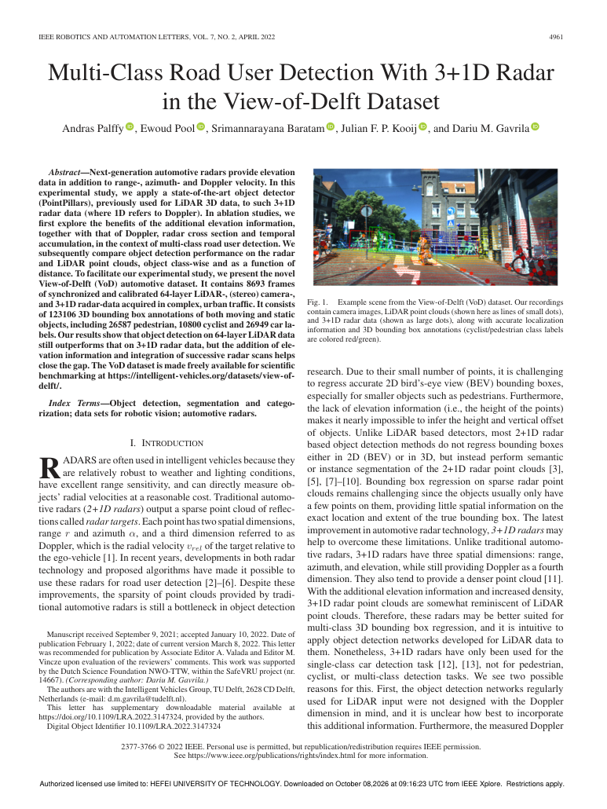

# P001｜Multi-Class Road User Detection With 3+1D Radar in the View-of-Delft Dataset

> 阅读进度：Title & Abstract → Introduction → Figure 1 → Related Work → View-of-Delft Dataset
> 笔记原则：保留原有学习内容与图片引用；区分**论文内容**、**基础知识补充**和**科研启发**。原笔记尚未覆盖的网络实现细节、完整定量结果不作推断。

## 学习总览

**核心问题**：新一代具备俯仰角测量能力的车载 Radar，能否支持汽车、行人、骑行者的多类别 3D 检测？Elevation、Doppler、RCS 和多帧累积分别有什么价值？

**研究路线**：新雷达提供更丰富的空间与运动信息 → 使用成熟的 PointPillars 检测器验证 → 对雷达信息做消融 → 借助 View-of-Delft（VoD）开展多类别评估。

**一条主线**：Radar 并非“低配 LiDAR”；它的几何表达较稀疏，却拥有径向速度、雷达散射截面等独特物理信息。后续雷视融合研究应同时关注**几何、语义、运动和可靠性**。

---

## Step 1｜Title + Abstract：先弄清论文做什么

### 1.1 论文基本信息

| 项目 | 内容 |
|---|---|
| 题目 | Multi-Class Road User Detection With 3+1D Radar in the View-of-Delft Dataset |
| 研究任务 | 使用 3+1D Radar 进行多类别道路参与者 3D 目标检测 |
| 主要对象 | Car、Pedestrian、Cyclist |
| 数据集 | View-of-Delft（VoD） |
| 基础检测框架 | PointPillars |
| 核心分析 | Elevation、Doppler、RCS、多帧累积对检测的贡献 |

### 1.2 3+1D Radar 是什么意思？

- **3 个空间测量量**：Range（距离）、Azimuth（方位角）、Elevation（俯仰角）。
- **+1 个运动测量量**：Doppler / Radial Velocity（多普勒/径向速度）。

传统 **2+1D Radar** 通常具备距离、方位角与径向速度信息，但缺少可靠的俯仰角测量。**3+1D Radar** 加入俯仰角后，雷达点可以定位到三维空间。

**基础知识补充｜3+1D 与 4D Radar：**在车载感知语境中，两者经常指向同类能力（距离、方位、俯仰、径向速度），但“4D”是业界常见称呼，具体数据输出与分辨率仍取决于硬件。**不要把 4D Radar 理解成直接测出完整三维速度 (vx, vy, vz)**：单个雷达点的 Doppler 通常仅对应视线方向的速度分量。

**基础知识补充｜从球坐标到三维点**（假设方位角 α 从水平 x 轴计、俯仰角 β 从水平面计）：

\[
x=r\cos\beta\cos\alpha,\quad y=r\cos\beta\sin\alpha,\quad z=r\sin\beta
\]

坐标轴方向与角度正负约定需以具体数据集的坐标系定义为准。

### 1.3 研究动机与方法选择

作者要回答的不是“新雷达的信息更多，所以一定更好”，而是：**这些新信息能否转化为实际的 3D 检测收益？**

**为什么选 PointPillars？** PointPillars 是成熟的点云 3D 检测框架，可作为相对清晰的 Baseline，帮助研究者优先评估数据及其特征的价值，而非一开始就把提升归因于复杂网络设计。它原本面向 LiDAR，迁移到 Radar 时仍需要考虑点密度、噪声和特征差异。

### 1.4 信息贡献分析（Ablation）

| 变量 | 含义 | 要检验的问题 |
|---|---|---|
| Elevation | 俯仰角/高度信息 | 是否改善三维定位及 3D Box 估计？ |
| Doppler | 径向速度 | 运动信息是否有助于识别和检测？ |
| RCS | 雷达散射截面 | 反射强弱特征能否提供有效判别信息？ |
| Temporal Accumulation | 多帧点云累积 | 更多点是否能弥补单帧稀疏？ |

**重要区别**：消融实验用于比较各信息源的贡献；某种特征“存在”，不代表它在所有场景、类别和模型中都必然有效。

### 1.5 主要结论（依据原学习稿的定性总结）

原笔记概括：LiDAR 整体 3D 检测性能仍优于 3+1D Radar；Elevation 与连续多帧累积有助于缩小性能差距。**当前尚未整理具体指标、类别差异和实验设置，因此先保留为定性结论，不扩展为精确数值判断。**

**科研启发**：先验证新增物理信息是否有效，再考虑设计专用融合模型；实验必须回答“到底哪一种信息起作用”。

---

## Step 2｜Introduction：为什么值得研究

### 2.1 Radar 的优势与局限

Radar 在低光照和部分恶劣天气下通常比纯视觉更稳定；能测距、测径向速度，具有实际部署价值。但 Radar 并非不受天气影响：强降雨、杂波、多径、低反射目标等仍可能导致测量退化。

| 模态 | 主要优势 | 主要局限 |
|---|---|---|
| Camera | 类别、纹理、颜色、语义和场景上下文 | 受光照、遮挡、模糊及天气影响 |
| LiDAR | 较丰富的 3D 几何和目标轮廓 | 成本、天气及表面反射条件等影响 |
| 3+1D Radar | 距离、三维空间位置、径向速度、RCS | 点稀疏、散射不规则、角分辨率有限、噪声与多径 |

### 2.2 传统 Radar 为什么难做 3D Detection？

**限制一：点云稀疏。** 同一个汽车可能只对应少数散射点，难以从点云恢复目标中心、尺寸与完整轮廓，因此 3D Bounding Box Regression（3D 边界框回归）较困难。

**限制二：缺少可靠 Elevation。** 仅凭距离与方位角很难确定点的垂直位置，也难以推断目标高度。

传统 Radar → 点云稀疏、垂直几何不足 → 完整 3D 检测困难。

3+1D Radar → 增加 Elevation、通常具有更丰富的点云 → 3D 几何表达改善 → 有潜力直接使用点云检测器。

**注意**：增加 Elevation 不等于目标轮廓自动完整，也不保证所有 3+1D 雷达的点云都更密集；点数与硬件、场景、检测阈值等有关。

### 2.3 为什么可以迁移 LiDAR Detector？

两者最终都可以表示为空间点集合：

- LiDAR Point：常见属性为 `(x, y, z, intensity)`。
- Radar Point：常见属性为 `(x, y, z, Doppler, RCS, …)`。

**相似处**：都可以输入点云处理网络。**差异处**：测量机理、点分布、误差和物理属性不同，因此不能把 Radar 简单当作“稀疏 LiDAR”。

### 2.4 Research Gap：三个层次

1. **Radar-specific attributes 尚需系统验证**：Doppler、RCS 等属性是否能改善 3D Detection？
2. **LiDAR 方法不能不加修改地照搬**：Radar 点稀疏、噪声较强、散射不规则；预处理、特征使用和 Data Augmentation 需要适配。
3. **当时缺少足够的数据与多类别 Benchmark**：尤其需要支持汽车、行人、骑行者的系统评估。

这里的“缺口”是**论文发表时的研究背景**，不是对 2026 年最新文献现状的判断。

### 2.5 Contributions：作者的贡献

- 使用并适配 PointPillars，探索 3+1D Radar 的多类别 3D 检测能力。
- 分析 Elevation、Doppler、RCS、Temporal Accumulation 的实际作用。
- 提供 View-of-Delft 多传感器数据与 3D 标注，为后续感知研究提供基础。

### 2.6 科研问题如何形成？

旧传感器局限 → 新硬件提供潜在解决手段 → 缺少系统验证/数据 → 建立 Benchmark → 用 Baseline 和 Ablation 验证。

**科研启发**：创新不一定来自更复杂的网络；新的传感器能力、数据组织方式和严谨的验证问题也可以构成研究贡献。

---

## Step 2A｜Figure 1：读懂多模态数据

### 2A.1 原图（保留原笔记图片引用）



> 原笔记使用 Obsidian 图片嵌入语法。若要在其他 Markdown 阅读器显示，请将图片放在对应附件目录并改成相对路径。当前上传的 TXT 中未包含图片文件，故不替换或重新绘制原图。

### 2A.2 Figure 1 要表达什么？

同一个道路场景，在 Camera、LiDAR、Radar 中呈现的内容不同：

- **Camera → Semantic / Appearance**：可以识别“是什么”，如汽车、行人、骑行者及其外观。
- **LiDAR → Dense 3D Geometry**：通常有较多空间点，较好反映表面和轮廓。
- **Radar → Sparse Geometry + Motion / Physical Attributes**：点更稀疏、不规则，但能提供径向速度与 RCS。

### 2A.3 Radar-Camera Fusion 的互补关系

Camera 回答 **What is it?**；Radar 为 **Where is it? How is it moving along the line of sight?** 提供物理证据。二者融合的重点不是拼接数据，而是建立同一目标在视觉与雷达观测之间的对应关系，并在观测冲突时判断证据是否可靠。

**科研启发（非论文已验证结论）**：当 Camera/VLM 在夜间、模糊或遮挡下判断不可靠时，Radar 的距离、径向速度和 RCS 能否提供可验证的物理约束？这一问题值得放入 Innovation Bank，但目前不能认定为新颖创新点。

---

## Step 3｜Related Work：把论文放进技术发展脉络

### 3.1 传统 2+1D Radar 检测方法

既有研究尝试 Clustering（聚类）、CNN、Point Cloud Neural Network（点云神经网络）、多帧累积、多 Radar、低层雷达表示，以及与 Camera / LiDAR 融合等方法。

这些工作针对的共同困难是：**单帧雷达几何信息不足，难以稳定回归完整 3D Box**。但不能因此推断早期方法完全不能做 3D 检测；应区分任务、数据条件与性能水平。

### 3.2 常见补偿策略

| 策略 | 主要作用 | 潜在代价 |
|---|---|---|
| 多帧累积 | 增加点数与可见散射信息 | 运动拖影、时延、配准误差 |
| 多 Radar | 增加视角与覆盖范围 | 硬件、标定和融合复杂度 |
| 低层雷达表示 | 保留更多原始信号结构 | 数据量、处理成本、可获取性 |
| Radar-Camera / LiDAR Fusion | 利用模态互补 | 时间同步、空间标定、跨模态关联 |

### 3.3 本文的定位

传统 Radar 的局限 → 3+1D Radar 提供 Elevation 等新能力 → 需要多类别检测验证 → 使用 VoD + PointPillars + 信息消融。

**阅读时特别注意**：Related Work 中的“当时研究较少”不能直接照搬到现在的论文引言。若后续投稿，必须重新检索近年的 4D Radar、Radar-Camera Fusion 与 Radar-Language 工作。

---

## Step 4｜View-of-Delft Dataset：理解数据是如何构成的

### 4.1 数据集的目的与模态

VoD 是面向道路场景多类别 3D 感知的多传感器数据集，包含 3+1D Radar、Stereo Camera、64-layer LiDAR 和自车 Odometry。多传感器数据的空间标定与时间组织使其可用于 Radar-only Detection、Radar-Camera Fusion、模态比较、Tracking 和其他时序感知研究。

### 4.2 Sensor Setup（保留原笔记记录）

| 传感器 | 设备/配置 | 原笔记所记频率 | 主要信息 |
|---|---|---|---|
| 3+1D Radar | ZF FRGen21，前保险杠后方 | 约 13 Hz | Range、Azimuth、Elevation、Doppler、RCS |
| Stereo Camera | 挡风玻璃处，约 1936×1216 | 约 30 Hz | 外观、纹理、颜色、语义 |
| LiDAR | Velodyne HDL-64 S3，车顶，64 线 | 约 10 Hz | 3D 几何与物体表面 |
| Ego-vehicle Odometry | RTK GPS、IMU、车轮里程计融合 | 原笔记后文记约 100 Hz | 自车位置与姿态变化 |

以上是**原学习稿中的设备与参数记录**；本次未对照原论文逐项核查，不作为独立核验后的官方参数表。

### 4.3 Calibration：空间对齐（Where?）

Camera、Radar、LiDAR 各有自己的坐标系。Calibration（标定）用于确定不同传感器之间的几何关系，使同一目标的测量可以变换到统一坐标系。

**基础知识补充｜刚体坐标变换**：

\[
\mathbf p_C=\mathbf R_{CR}\mathbf p_R+\mathbf t_{CR}
\]

其中，`p_R` 是雷达坐标系中的点，`p_C` 是转换后的相机坐标系坐标；`R_CR` 表示旋转，`t_CR` 表示平移。要进一步映射到相机像素，还需要相机内参与投影模型。

**记忆**：Calibration 解决的是“同一个位置，在不同传感器坐标系里如何表示”。

### 4.4 Synchronization：时间对齐（When?）

不同传感器采样频率不同，观测并非天然同时。原笔记记录 VoD 以 LiDAR 时间戳为参考，选择时间最接近的其他传感器数据组成同步帧，允许的最大时间差约为 0.05 s，组织后的帧率约 10 Hz。

**为什么需要？** 目标或自车在移动时，即使外参完全正确，不同时刻的数据也可能不再描述同一空间状态。

**注意**：最近邻时间匹配只是时间同步的一种组织方式，并不意味着完全消除时间差；高速运动场景还可能需要时间插值或运动补偿。

| 概念 | 主要问题 | 简记 |
|---|---|---|
| Calibration | 不同传感器在空间上如何对应？ | Where? |
| Synchronization | 不同传感器在时间上如何对应？ | When? |

### 4.5 Frame 与 Clip

**Frame（同步帧）**：同一时间附近的 Radar、Camera、LiDAR 和 Odometry 观测组合，可理解为一次多传感器联合快照。**Clip（片段）**：按时间连续排列的一组 Frame。原笔记记录平均 Clip 时长约 40 s。

### 4.6 Odometry：里程计

Odometry 描述自车在不同时刻的运动和位姿变化。这里的 **Ego** 指搭载传感器的车辆，不是检测到的其他车辆或行人。

**位姿（Pose）**通常包含平移与旋转；完整刚体位姿具有 6 个自由度：`x, y, z, roll, pitch, yaw`。

### 4.7 Ego-motion Compensation：自车运动补偿

车在移动时，静止路灯在前后帧的雷达坐标系里也会发生位置变化。直接把不同帧的点叠加，会让同一物体出现多个偏移位置。

因此需利用自车位姿，把不同时间的点变换到**同一参考时刻/参考坐标系**后再累积。

**关键区分**：

- **Ego-motion**：传感器所在车辆自身的运动。
- **Object Motion**：目标自身的运动。
- **Ego-motion Compensation**：主要补偿前者，不能自动消除行人、骑行者等目标的真实运动。

所以，多帧累积虽增加点数，也可能产生 **Motion Smearing（运动拖影）**：移动目标在不同时间的位置被叠加成拉长或错位的点云。

### 4.8 Annotation Range 与 3D Bounding Box

原笔记记录：VoD 标注部分或全部处于 Camera FoV（水平 ±32°、垂直 ±22°）内、距离 LiDAR 50 m 范围内的静态与动态目标。该范围为**标注规则的原笔记记录**，不等于雷达的最大测量距离。

**3D Bounding Box**：用三维空间中的盒子描述目标的位置、大小和方向。

**必须区分两个概念：**

| 概念 | 常见参数 | 说明 |
|---|---|---|
| 6-DoF Pose（六自由度位姿） | x、y、z、roll、pitch、yaw | 三维平移 + 三维旋转；**不包含尺寸** |
| 3D Bounding Box（3D 边界框） | 中心位置、长宽高、方向 | 既有位姿，也有尺寸；具体参数数量取决于数据集定义 |

原笔记称论文使用“6-DoF 3D Bounding Box”，并提及后续文档的“9-DoF”表述。**这两种说法需要回到论文与官方标注格式核对：6-DoF 通常严格指位姿，不应直接等同于带尺寸的完整 3D Box。** 如果用中心 `(x,y,z)` + 尺寸 `(l,w,h)` + 三轴姿态 `(roll,pitch,yaw)` 表示，总共是 9 个标量参数；但不代表所有数据集均采用这一表示。

**六自由度直观理解**：

- 平移：x（前后）、y（左右）、z（上下），具体方向取决于坐标系。
- 旋转：roll（绕 x 轴）、pitch（绕 y 轴）、yaw（绕 z 轴）。

### 4.9 类别、遮挡、活动状态与 Object ID

- **Annotated Classes**：原笔记记录共 13 类道路参与者，包括 Car、Pedestrian、Cyclist 等；本文关注其中的主要检测类别。
- **Occlusion**：原笔记区分 Spatial Occlusion（物体遮挡）与 Lighting Occlusion（光照相关可见性下降）。两者是不同的可见性退化因素，具体标签名称应以官方字段为准。
- **Activity Attribute**：例如 stopped、moving、parked、pushed、sitting，用于补充目标活动状态。
- **Unique Object ID**：若同一目标在多个 Frame 中保留一致标识，可支持跨帧关联、Tracking 和轨迹分析。

**重要限定**：原笔记描述了这些属性的用途，但本次未逐字段验证其是否全部出现在同一版公开标注中。后续实际写数据加载器时，要检查官方数据字典与标注文件。

### 4.10 为什么 VoD 对 Radar-Camera Fusion 有价值？

它把 Camera 语义、Radar 物理/运动信息、LiDAR 几何信息、时序与标注组织在同一个多传感器数据体系中，为跨模态对齐和联合检测提供基础。

**基础数据链**：

```text
真实交通场景
  ├─ Radar ────── 物理属性 / 径向运动
  ├─ Camera ───── 视觉外观 / 语义
  ├─ LiDAR ────── 三维几何
  └─ Odometry ─── 自车位姿
          ↓
     Calibration（空间对齐）
          +
     Synchronization（时间对齐）
          ↓
     必要时进行运动补偿
          ↓
     Multi-sensor Frames / Clips
          +
     3D Annotations
          ↓
     Detection / Fusion / Tracking / Prediction
```

注意：**标定、同步、运动补偿和人工标注不是一条完全串行的传感器处理流水线**；这里画的是概念关系。

### 4.11 对 RadarVisionLLM 的启发（研究假设，非论文贡献）

- Camera → Semantic Evidence（语义证据）
- Radar → Physical / Motion Evidence（物理和运动证据）
- Temporal Sequence → Motion Evolution（运动变化）
- Annotation → Object-level Ground Truth（目标级真值）

**可探索的问题**：能否让模型把视觉判断与 Radar 的距离、径向速度等证据绑定到同一个目标，并在视觉退化或模态冲突时显式表达不确定性？这与后续 Sensor Grounding、Uncertainty-aware Fusion 和 Radar-Language Reasoning 有联系，但需要进一步查新。

---

## 复习卡片｜本阶段必须掌握

| 层级 | 内容 | 能否解释清楚的自测问题 |
|---|---|---|
| 必须掌握 | 3+1D Radar | 3 个空间量和 +1 个运动量分别是什么？ |
| 必须掌握 | Doppler | 为什么单点 Doppler 不等于目标完整三维速度？ |
| 必须掌握 | 传感器互补 | Camera、LiDAR、Radar 各自强在哪里？ |
| 必须掌握 | Calibration / Synchronization | 一个解决 Where，一个解决 When，为什么缺一不可？ |
| 必须掌握 | Ego-motion Compensation | 为什么静止路灯在多帧中也可能错位？ |
| 必须掌握 | 6-DoF / 3D Box | 六自由度位姿是否包含长宽高？ |
| 理解即可 | PointPillars 迁移 | 为什么用成熟 Baseline 验证新传感器？ |
| 理解即可 | Ablation | 怎样证明提升来自 Elevation 而不是多帧累积？ |
| 理解即可 | VoD 数据组织 | Frame、Clip、Annotation、Object ID 有何联系？ |
| 暂时了解 | 低层 Radar Representation | 为什么可能保留更多信息，但计算和获取更复杂？ |
| 暂时了解 | Radar-Language Grounding | 如何把语言描述绑定到雷达物理证据？ |

## 待核对与下一步精读

1. 对照论文核对：3D Box 的自由度表述、传感器参数、同步容差、标注范围、遮挡字段与 Activity / ID 的官方定义。
2. 阅读 **Method**：Radar point feature 具体输入哪些维度？PointPillars 哪些部分进行了适配？
3. 阅读 **Experiments**：明确评价指标、距离划分、类别结果、单帧/多帧设置。
4. 阅读 **Ablation**：分别记录 Elevation、Doppler、RCS、Temporal Accumulation 的数值变化，避免仅记“有用”。
5. 记录可复现资源：数据下载入口、官方代码、训练配置、模型权重及版本信息（目前原笔记未提供，暂不填写）。

**本阶段一句话总结**：这篇论文通过 VoD 数据集、成熟点云检测框架与特征消融，研究新一代具备俯仰角测量能力的 Radar 在多类别 3D 检测中的价值；对我们的长期主线，最重要的启示是**不要仅融合模态，而要验证每一种物理信息是否真正提供独立、可靠的证据**。


---
# P001 结项补充｜Method、Experiments、Discussion（2026-10-13 原文核查）

> **阅读状态更新**：前面章节保留了 2026-10-12 阶段性笔记及当时“尚未覆盖”的措辞；以下为对照论文 8 页全文补充的正式精读内容。涉及相同主题时，以原文核查结果为准。复现状态仍为 **Planned**，并未训练模型。

## Step 5｜Methodology：PointPillars 与 Radar 特征

**原文位置：PDF 第 4–5 页，IV. METHODOLOGY。**

- 雷达单点原始特征为 `(r, α, θ, v_rel, RCS)`，其中距离、方位、俯仰可变换为 `(x,y,z)`，从而得到 `(x,y,z,v_rel,RCS)`。这是 **5 个输入特征**，不是直接输出完整三维速度。
- 作者进一步计算自车运动补偿后的径向速度 `v_r`，作为附加的 Doppler 特征（decoration），并做零均值、单位标准差归一化。**注意**：补偿自车运动后得到的仍是径向速度，而非目标三维速度向量。
- **PointPillars**：将点云分配到水平网格柱（pillar），对每个柱内点特征进行编码，再由二维卷积骨干网络提取 BEV 特征并预测三维目标框。P001 使用该成熟模型比较不同传感器/特征的检测性能，非提出全新融合网络。
- **多帧累积**：将过去扫描的点云通过坐标变换对齐到当前扫描坐标系，再合并。对齐用于减少自车运动造成的空间错位；动态目标自身运动仍可能造成残影/拖尾。论文讨论多帧既增加点数，也可能提供时间变化信息，后者属于作者推测而非单独因果验证。
- **数据增强**：以论文 IV-C 原文和复现配置为准；不可将常见 PointPillars 增强策略直接宣称为本文全部实际设置。

## Step 6｜Experiments：必须记住的结果

**原文位置：PDF 第 5–6 页，V. EXPERIMENTS；Table IV（PDF 第 6 页）。**

### 6.1 评价协议

- 训练/验证/测试按 **59% / 15% / 26%** 的 clip 级拆分，避免同一 clip 的帧跨集合；论文报告测试结果。**注意**：其他后续论文使用 VoD 验证集的实验不能直接混成同一协议。
- AP 基于 **3D IoU**：Car 阈值 0.5，Pedestrian 与 Cyclist 阈值 0.25；mAP 为三类 AP 的均值。另报告 AOS/mAOS（方向相似度）。
- 两个区域：整个标注区域（相机 FoV 内、最远 50 m）与 **Driving Corridor**（相机坐标中 `-4 m < x < 4 m, z < 25 m`）。

### 6.2 Table IV 主要对照

| 实验配置 | 整个标注区域 mAP | 解释 |
|---|---:|---|
| PP-radar（单帧、完整特征） | 38.0 | Radar 基线 |
| PP-radar（去 Doppler） | 29.1 | Doppler 对检测有重要作用 |
| PP-radar（去 Elevation） | 31.9 | 俯仰/高度信息有益 |
| PP-radar（去 RCS） | 36.6 | RCS 有正向贡献，幅度较小 |
| PP-radar（3 scans） | 46.3 | 时间累积提高性能 |
| PP-radar（5 scans） | 47.0 | 比 3 帧仅小幅增加 |
| PP-LiDAR | 62.1 | 同一 PointPillars 检测框架下的 LiDAR 基线 |

**额外结果**：单帧 Radar 三类 AP：Pedestrian 34.9、Cyclist 43.1、Car 36.0；五帧 Radar mAOS 39.6，单帧 30.5。Driving Corridor：单帧 Radar mAP 63.0、五帧 Radar 71.4、LiDAR 81.6。推理前向传播时间约 Radar 7.8 ms、LiDAR 12.9 ms，**不代表端到端实时延迟**。

### 6.3 Fig.4 距离与检测性能

- Fig.4 对比雷达（实线圆点）和 LiDAR（虚线菱形）在不同距离下的类别检测表现；近距离车辆通常更易检出。图像支持**距离相关的性能变化**，但不能单凭曲线断言 RCS 是唯一或主要因果机制。
- 后续拟定的 `0–10/10–20/20–30/30–40/40–50 m` 分组是**我们建议的实验方案**，并非本文原文报告的统一分组设置。

### 6.4 Fig.5 IoU 阈值与定位精度

- 随 3D IoU 要求提高，Radar 的检测表现比 LiDAR 更早下降。说明分类/发现目标与精准定位是两回事；雷达可能发现目标，但框的位置、尺寸或朝向不够精确。

## Step 7｜Discussion 与 Conclusion

**原文位置：PDF 第 6–7 页，VI–VII。**

1. 作者报告在标注区域内平均点数 LiDAR **21,344**、Radar **216**；同时指出两种传感器的安装高度不同，LiDAR 位于车顶、雷达位于前保险杠附近，遮挡条件不同。因此两者差距不能全部归因于点云密度。
2. 骑行者在使用 Doppler 的 Radar 方法中表现较好；作者结合骑行者运动、车轮与金属车架反射解释此现象，属于论文讨论中的机制解释，不等于已通过专门消融验证。
3. 五帧累积缩小与 LiDAR 的差距，但仍未达到 LiDAR mAP。进一步增加帧数未必线性获益，需考虑运动模糊、时延与计算成本。
4. 作者认为提升雷达分辨率、改进目标提取（peak finding）、利用更低层的 radar cube 可能带来进一步改善；这是未来方向，不是本文已完成实验。

## Step 8｜科研问题、证据边界与下一步

**研究问题**：在点云稀疏且目标距离增大时，是否可以结合距离、RCS、局部密度与时间信息改善 Radar-only 检测，或与相机形成互补？

**证据链**：Fig.4 距离曲线 + Fig.7(d) 远距离行人少量反射的失败案例 + Table IV RCS/多帧消融 + Discussion 平均点数差异。

**不能直接得出的结论**：① RCS 随距离降低是本文性能下降的已验证主因；② 通过归一化 RCS 可以恢复缺失雷达回波；③ 点云扩散得到的深度估计等于真实雷达测量；④ 本研究方向尚无人发表。

**待验证的最小实验**：固定 VoD 数据划分、模型和训练策略，先输出分距离/分类别 AP 与 Recall、每目标点数分布、RCS 分布，再进行有无距离/密度/RCS 特征增强的对照，记录误检、推理时延和训练随机种子。

## 术语与能力检查

| 术语 | 关键理解 |
|---|---|
| 3+1D Radar | 距离/方位/俯仰 + Doppler；不等于 3D 速度 |
| RCS | Radar Cross Section，雷达散射截面；受材质、姿态、视角等影响 |
| PointPillars | 点云柱体编码 + BEV 检测 |
| Ego-motion Compensation | 自车运动补偿；与动态目标运动补偿不同 |
| Temporal Accumulation | 历史扫描空间对齐并合并 |
| 3D IoU | 预测框与真值框三维交并比 |
| AP / mAP | 单类精度-召回汇总指标 / 类别均值 |
| AOS / mAOS | 方向估计质量指标 |

**P001 结项结论**：精读与原文核查已完成；复现尚未开始。下一步应核查官方代码/数据许可并建立可运行基线，P002（DDCFusion）可另行开展精读。
